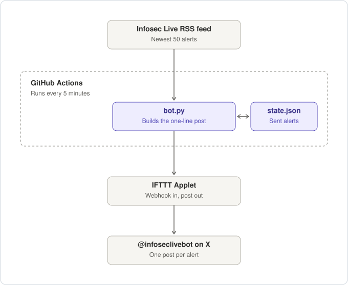

# Infosec Live X bot

This bot posts each new [Infosec Live](https://t.me/s/infoseclive) security
alert to X, on [@infoseclivebot](https://x.com/infoseclivebot).



GitHub Actions runs `bot.py` every 5 minutes. The script reads the RSS feed,
skips the alerts that it has already sent, and sends each new alert to an
IFTTT Applet. The Applet posts it to X.

A post looks like this:

```text
🟠 HIGH 8/10: HYPERLIQUID XMR1 DEPLOYER WALLET SUSPECTED COMPROMISE, ~$13.3M DUMPED

The XMR1 (wrapped Monero) deployer wallet on Hyperliquid sent 5.2M XMR1 to a fresh address (0x1464dAcaCeB0d511f9964cDac5ebA50ea42220Bf), which sold it into the order book for ~13.3M USDC, crashing XMR1 from ~$494 to ~$1 in about 35 minutes, then bought ~7,467 ETH and bridged most of it to Ethereum. Flagged by Scam Sniffer and Lookonchain; no official issuer statement yet.

https://www.lookonchain.com/feeds/83263
```

The headline, the description and the link come from the alert. The bot posts
alerts with a score of 7 or higher: 9 and 10 are CRITICAL (🚨), 7 and 8 are
HIGH (🟠).

To set up the bot or run it yourself, see [SETUP.md](SETUP.md).
